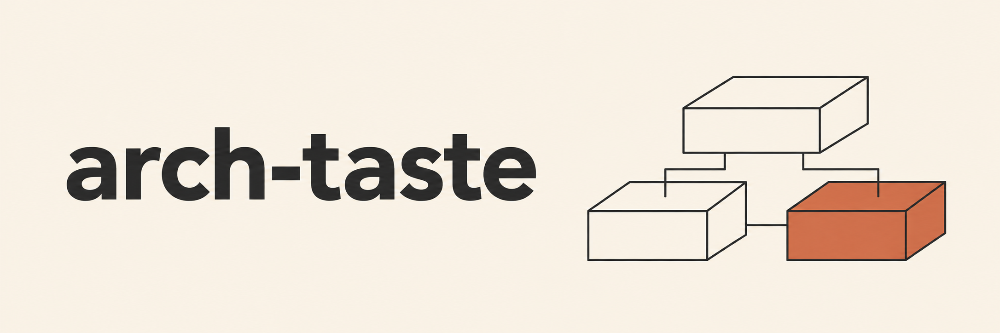

# arch-taste

[](SKILL.md)
[](#快速上手)

把软件架构和工程偏好写成一份可跨项目复用的 Skill，可在 Codex 和 DeepSeek Harness（DSH）中使用。从技术选型到交付，让 Agent 按同一套偏好做决策。

## 包含哪些偏好

- **技术选型** · 静态语言优先 Rust，动态技术栈优先 Bun + TypeScript。Web UI 优先考虑 TanStack，桌面 GUI 按原生交互与性能要求选 Tauri 或 GPUI。
- **架构与代码** · 优先组合，分离纯逻辑与副作用，明确模块边界。采用语言惯用写法，保持代码和测试精简。
- **性能与可靠性** · 关键操作记录日志，失败和降级可见。外部接口对可安全重试的错误做指数退避，性能提升用 benchmark 验证。
- **开发与交付** · 新功能用 Git worktree，架构变更同步更新 `architecture.md`。合并到 `main` 和修改线上数据库需要用户明确同意。

完整规则见 [SKILL.md](SKILL.md)。

## 快速上手

先从 [GitHub Releases](https://github.com/RoggeOhta/arch-taste/releases/latest) 下载源码并解压。打开包含 `SKILL.md` 的目录，运行以下命令。Codex 和使用默认 Skill 目录的 DSH 可以共用这份用户级安装。

```sh
mkdir -p "$HOME/.agents/skills/arch-taste"
cp -i SKILL.md "$HOME/.agents/skills/arch-taste/SKILL.md"
```

安装后，在 Codex 输入框里输入 `$`，确认列表中出现 `arch-taste`。如果列表还没更新，重启 Codex 后再试。在 DSH 的会话输入框中使用 `/` 菜单查找 `arch-taste`。 [Codex Skills 文档](https://developers.openai.com/codex/skills)

```text
$arch-taste 为一个新的跨平台 Rust CLI 做架构设计。只输出设计，说明模块边界、平台差异如何隔离，以及多目标如何共用 Cargo workspace。
```

预期输出会说明共享逻辑和平台专属实现各放在哪里，以及如何通过条件编译选用目标平台的实现。

## 复制给你的 AI Agent

把本项目的 GitHub 链接或 `SKILL.md` 一起交给 Agent，再发送下面这段话。

```text
请读取我提供的 arch-taste 项目中的 SKILL.md，把它作为后续软件架构、技术选型和开发交付的工程偏好。

如果你是 Codex 或使用默认 Skill 目录的 DeepSeek Harness，请把 SKILL.md 安装到 ~/.agents/skills/arch-taste/SKILL.md。如果目标已有文件，先比较内容并告诉我差异。如果你使用其他 Agent，按当前工具支持的方式加载这份说明。

接入后，告诉我实际加载的位置和调用方法。用一个新建跨平台 Rust CLI 的设计作为验证，说明共享 Cargo workspace、条件编译和模块边界怎么安排。验证只输出设计，不修改业务代码。
```
